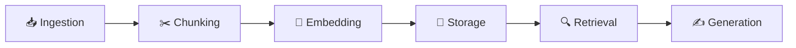

<div align="center">

# 🧠 RAG — Teaching the AI New Tricks

### *Give the professor the handbook, not a new brain.*


</div>

---

## 💡 The Big Idea

A normal LLM is very smart, but it only knows **what it was trained on** and **what you put into the current prompt**.

**RAG** solves this by **searching your own documents first**, then handing the most relevant information to the AI *before* it answers.

> 📖 **RAG is like giving an AI an open-book exam.**

---

## 📚 Table of Contents

1. [The Problem: The Isolated Professor](#-1-the-problem-the-isolated-professor)
2. [The Solution: What Is RAG?](#-2-the-solution-what-is-rag)
3. [Core Concepts](#-3-core-concepts)
4. [The RAG Pipeline](#-4-the-rag-pipeline)
5. [End-to-End Example](#-5-end-to-end-example)
6. [One-Minute Summary](#-one-minute-summary)

---

## 🔒 1. The Problem: The Isolated Professor

Imagine hiring a brilliant Computer Science professor who understands JavaScript, React, Node.js, APIs, databases, and programming logic. Now **lock them in a room** with:

- ❌ no internet connection
- ❌ no updated class schedule
- ❌ no Evangadi course calendar
- ❌ no pricing sheet
- ❌ no student handbook or internal notes

The professor is still intelligent — but **isolated**. They can answer general programming questions, but not questions about information they were never given.

> 🎯 **Teaching point:** An LLM can be excellent at reasoning and language, yet still fail because it doesn't have the correct information available at answer time.

### ⚠️ Three Limitations of Standard LLMs

| # | Limitation | What It Means | Example |
|---|-----------|---------------|---------|
| 1 | 🕰️ **Knowledge Cutoff** | The model is frozen at its training date and doesn't learn new schedules, prices, or policies. | *"When does the next Evangadi batch start?"* — the schedule may have been created after training. |
| 2 | 🔐 **Private Data** | Company info (prices, schedules, policies) isn't in public training data. | *"How much is the Full Stack class?"* — the model guesses a generic price. |
| 3 | 🎭 **Hallucination** | The model gives confident answers that aren't supported by facts. | A wrong price, start date, or policy creates confusion and support problems. |

### 🚫 Hallucination in Action

| Question | Bad Answer | Why It Is Bad |
|----------|-----------|---------------|
| When does Phase 3 start? | *"It starts next Monday."* | The model guessed instead of checking the official schedule. |
| How much is the class? | *"Around $5,000."* | Uses general knowledge, not Evangadi data. |
| Can I join late? | *"Yes, always."* | The real rule may depend on the current cohort policy. |

### 🛠️ The Old Solution: Fine-Tuning

Fine-tuning means training an existing model further on your own examples — like sending the professor to orientation to memorize company documents.

| ✅ Fine-tuning is better for | ✅ RAG is better for |
|---|---|
| Changing **behavior, tone, style** | Changing **facts** |
| Repeated **output format** | **Private documents**, schedules, prices, FAQs, policies |

If the schedule changes every month, retraining every month is **slow, costly, and unnecessary**.

---

## 🔎 2. The Solution: What Is RAG?

**RAG = Retrieval-Augmented Generation** — making an AI answer using external information retrieved *at the moment the user asks a question*.

| Part | Meaning | Simple Explanation |
|------|---------|--------------------|
| 🔍 **Retrieval** | Search for relevant information | Find the right page, paragraph, or chunk from your documents. |
| ➕ **Augmented** | Add that information to the prompt | Give the AI the evidence before asking it to answer. |
| ✍️ **Generation** | Let the LLM write the final response | The AI reads the context and produces a clear answer. |

### 📘 Give the Professor the Handbook

Instead of changing the professor's brain, we hand them the correct page at the moment the question is asked:

1. 🙋 The student asks: *"When does the Phase 3 React class start?"*
2. 🔍 The system searches the Evangadi course calendar.
3. 📄 The system retrieves the paragraph containing the Phase 3 start date.
4. 📨 The system sends **both** the question and the retrieved paragraph to the LLM.
5. 💬 The LLM answers based on that paragraph.

> ❗ **Important:** RAG does **not** make the model permanently memorize your data. It gives the model the right data **temporarily, inside the current request**.

### 🤝 Why RAG Works

- 🔍 The **search system** is responsible for finding evidence.
- 🗣️ The **LLM** is responsible for turning evidence into a useful answer.
- 📏 The **prompt rules** are responsible for stopping unsupported guessing.

---

## 🧩 3. Core Concepts

### 🪟 Concept A: The Context Window

The maximum amount of text an LLM can read in one request. It includes the system prompt, user question, retrieved context, previous chat messages, and instructions.

Even with a large window, sending too much is a bad habit — it **increases cost, slows responses, and makes it harder for the model to focus**.

| ❌ Bad idea | ✅ Better idea |
|---|---|
| Send a 10,000-page textbook for every question. | Search the textbook and send only the few most relevant paragraphs. |

> RAG depends on **selecting the right context**, not on sending all available text.

### 📦 Concept B: Context Stuffing

Placing the retrieved text directly inside the prompt that goes to the LLM. This is the **"Augmented"** part of RAG.

```text
System Prompt:
You are a helpful Evangadi assistant.
Use only the context below to answer the student.

Context:
[PASTE RETRIEVED TEXT HERE]

Student Question:
[PASTE USER QUESTION HERE]
```

The LLM isn't asked to *remember* the answer — it's asked to *read* the context and answer from it.

### 🛡️ Concept C: Hallucination Prevention

Strict rules that stop the AI from guessing when the answer isn't in the retrieved context:

```text
If the answer is not found in the provided context, say:
"I do not know based on the provided information."
Do not use outside knowledge.
Do not guess.
Do not invent details.
```

This matters most for business chatbots, which should **not** answer from general internet knowledge.

---

## 🏗️ 4. The RAG Pipeline

Think of it as a **library system for the AI**: first organize the documents, then search the library when a question arrives.



```text
Ingestion -> Chunking -> Embedding -> Storage -> Retrieval -> Generation
```

### 📥 Step 1 — Ingestion: Loading the Data

Bring information into the system from text files, PDFs, Word docs, website pages, internal manuals, FAQs, or database records.

- 📄 **Example file:** `evangadi-info.txt`
- 🎯 **Goal:** Read the text so the application can process it.
- ✅ **Good practice:** Save metadata — file name, section title, date, source type. It helps show where an answer came from and filter by document type.

### ✂️ Step 2 — Chunking: Splitting the Text

Break large documents into smaller pieces that are easier to embed, store, search, and send to the LLM.

| ❌ Bad Chunking | ✅ Good Chunking |
|---|---|
| Cuts a sentence in half. | Keeps complete ideas together. |
| Creates chunks with no context. | Uses **overlap** so meaning continues between chunks. |
| Makes chunks too large to search accurately. | Uses medium-sized pieces that are specific but meaningful. |
| Ignores paragraphs and headings. | Uses paragraphs, sentences, and headings as natural boundaries. |

**🔁 Recursive chunking** — try larger boundaries first, smaller only when necessary:

1. Split by large sections or headings.
2. If still too large → split by paragraph.
3. If still too large → split by sentence.
4. If still too large → split by characters.

**🔗 Overlap** repeats a small part of the previous chunk in the next one (e.g., the last 50 characters of Chunk 1 appear at the start of Chunk 2).

> 💭 **Why it matters:** If one chunk ends with *"The Full Stack class price is"* and the next starts with *"$1000"*, the meaning is lost without overlap or better splitting.

### 🔢 Step 3 — Embedding: Translating Text into Meaning Vectors

An **embedding** is a list of numbers that represents the *meaning* of a piece of text.

```text
Text chunk:        "The Full Stack class price is $1000."
Embedding vector:  [0.13, -0.44, 0.82, 0.06, ...]
```

> ⚠️ The **same embedding model** must be used for both the stored chunks and the user question, so their meanings can be compared.

### 💾 Step 4 — Storage: Saving the Vectors

Save the original chunk text and its embedding vector for later search.

| Column | Purpose |
|--------|---------|
| `id` | Unique identifier for the chunk. |
| `content` | The actual text of the chunk. |
| `embedding` | The vector representation (often stored as JSON in the learning version). |
| `source` | The file or document the chunk came from. |
| `metadata` | Optional details such as section, page, topic, or date. |

> 🎓 **Learning setup:** MySQL with a JSON column.
> 🏭 **Production:** a vector database is usually better for large-scale similarity search.

### 🔍 Step 5 — Retrieval: Searching by Meaning

The question is converted into a vector, compared with every stored chunk vector, and chunks are ranked by **cosine similarity** — a high score means the question and chunk are close in meaning.

| Chunk | Similarity | Decision |
|-------|-----------:|----------|
| Chunk A: Full Stack class price is $1000. | **0.92** | ✅ Use this chunk. Very relevant. |
| Chunk B: React phase starts on Saturday. | **0.63** | 🤔 Maybe useful, but not about price. |
| Chunk C: Office holiday schedule. | **0.18** | ❌ Ignore. Not relevant. |

- 🏆 **Top-k** — select the top few chunks (e.g., top 3).
- 🚧 **Threshold** — ignore chunks below a minimum score (e.g., 0.70) so weak context doesn't confuse the LLM.

### ✍️ Step 6 — Generation: Producing the Final Answer

Put the retrieved chunks into a prompt, add the user question, and ask the LLM to answer **using only the provided context**.

```text
You are a helpful Evangadi Professor.
Use ONLY the context below.
If the answer is not in the context, say "I do not know based on the provided information."

Context:
[Top 3 retrieved chunks]

Question:
[Student question]

Answer:
```

> 🤝 The search system finds the evidence. The LLM explains the evidence.

---

## 🎬 5. End-to-End Example

**🙋 Student:** *"How much is the Full Stack class?"*

### ⚙️ Behind the Scenes

1. The application receives the student question.
2. The question is converted into an embedding vector.
3. That vector is compared with the stored document vectors.
4. The top matching chunks are selected.
5. The selected chunks are inserted into the prompt as context.
6. The LLM answers using only that context.

### 📄 Retrieved Context

```text
Chunk 1: The Full Stack Development class costs $1000. Students may contact
         support for payment options.

Chunk 2: The next Full Stack batch begins on Saturday. Orientation details
         will be sent by email.

Chunk 3: Students should complete registration before the start of the batch.
```

### ✅ Final Answer

> The Full Stack Development class costs $1000. For payment options, students should contact support.

Not a random guess — it's **grounded in the retrieved context**.

### 🚫 If the Answer Is Not Found

**🙋 Student:** *"Who is the CEO of Apple?"*

**Retrieved context:** Only Evangadi course information. No Apple CEO information appears.

**✅ Correct answer:**

> I do not know based on the provided information.

This may feel strict, but it's exactly what we want in a controlled company chatbot — it stays inside the knowledge base it was designed to use.

---

## ⏱️ One-Minute Summary

RAG is like giving an AI an **open-book exam**. The AI may not know a company schedule or price from memory, so the application first **searches the company documents**, finds the **most relevant paragraphs**, places them **into the prompt**, and tells the AI to **answer only from those paragraphs**.

This makes answers **more accurate**, **easier to update**, and **safer than guessing**.

> 🌉 RAG is the bridge between a general AI model and your own reliable knowledge base. It doesn't make the model magically know everything — it gives the model **the right information at the right time**.

---

<div align="center">

**Made for learning ❤️ — Retrieval • Augmentation • Generation**

</div>